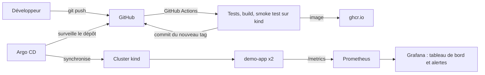

# k8s-gitops-lab

Un laboratoire Kubernetes reproductible, de bout en bout : un cluster local, une petite application Flask conteneurisée, un déploiement GitOps avec Argo CD et une supervision avec Prometheus et Grafana.

Le dépôt Git est la source de vérité : on pousse du code, la CI construit et publie l'image, met à jour le tag dans Git, et Argo CD synchronise le cluster tout seul.

## Architecture



## Composants

| Composant | Rôle |
|---|---|
| `kind.yaml` | Cluster kind à 3 nœuds (1 plan de contrôle, 2 workers) |
| `app/` | Application Flask instrumentée (`/`, `/healthz`, `/fail`, `/metrics`) |
| `deploy/app/` | Manifestes Kubernetes (Deployment, Service) avec Kustomize |
| `argocd/` | Trois `Application` Argo CD : l'application, kube-prometheus-stack, et les ressources de supervision |
| `monitoring/` | ServiceMonitor, règles d'alerte, tableau de bord Grafana |
| `.github/workflows/ci.yml` | Tests, smoke test sur un cluster kind éphémère, publication de l'image, mise à jour du tag |

## Prérequis

- Ubuntu avec 8 Go de RAM au minimum (kube-prometheus-stack est gourmand)
- Docker, kubectl et kind : `bash scripts/install-ubuntu.sh` les installe
- Un compte GitHub, et ce dépôt **public**

## Démarrage rapide

1. **Créez le dépôt sur GitHub** et poussez ce contenu sur la branche `main`.

2. **Remplacez le nom d'utilisateur** dans les manifestes :

   ```bash
   grep -rl GITHUB_USER . | xargs sed -i 's/GITHUB_USER/votre-nom-github/g'
   git commit -am "Configurer le dépôt" && git push
   ```

3. **Laissez la CI publier la première image** (onglet Actions). Une fois l'image publiée, passez le paquet en **public** dans GitHub (Packages, Package settings, Change visibility), sinon le cluster ne pourra pas la télécharger.

4. **Créez le cluster** :

   ```bash
   bash scripts/create-cluster.sh
   ```

5. **Installez Argo CD et les applications** :

   ```bash
   bash scripts/install-argocd.sh
   ```

   Le script affiche le mot de passe initial de l'utilisateur `admin`.

6. **Vérifiez le déploiement** :

   ```bash
   kubectl get applications -n argocd
   kubectl get pods -n demo
   kubectl -n demo port-forward svc/demo-app 8080:80
   curl localhost:8080/
   ```

## Accès aux interfaces

```bash
# Argo CD : https://localhost:8081 (admin)
kubectl -n argocd port-forward svc/argocd-server 8081:443

# Grafana : http://localhost:3000 (admin)
kubectl -n monitoring port-forward svc/kube-prometheus-stack-grafana 3000:80
kubectl -n monitoring get secret kube-prometheus-stack-grafana \
  -o jsonpath='{.data.admin-password}' | base64 -d; echo

# Prometheus : http://localhost:9090
kubectl -n monitoring port-forward svc/kube-prometheus-stack-prometheus 9090:9090
```

Le tableau de bord « Demo app » apparaît dans Grafana : requêtes par seconde, taux d'erreurs, latence p95, instances qui répondent.

## Tester l'alerte

L'alerte `DemoAppHighErrorRate` se déclenche quand plus de 5 % des requêtes renvoient une erreur 5xx pendant 2 minutes. Avec le `port-forward` de l'application actif :

```bash
while true; do
  curl -s -o /dev/null localhost:8080/fail
  curl -s -o /dev/null localhost:8080/
  sleep 0.2
done
```

Après quelques minutes, l'alerte passe en `Pending` puis `Firing` dans Prometheus (onglet Alerts) et dans Grafana.

## Démontrer le GitOps

- Modifiez `replicas` dans `deploy/app/deployment.yaml`, poussez : Argo CD ajuste le cluster.
- Changez le nombre de réplicas à la main avec `kubectl scale` : Argo CD annule la modification (`selfHeal`).
- Modifiez `app/main.py`, poussez : la CI publie une nouvelle image, met à jour le tag, et Argo CD déploie.

## Choix techniques

- **kind** plutôt que k3d : vrais nœuds kubeadm, standard en CI.
- **Kustomize** pour l'application : le tag de l'image est la seule valeur modifiée par la CI, ce qui garde un diff lisible dans Git.
- **Image taguée par SHA** : chaque déploiement est traçable jusqu'à un commit.
- **Un seul worker gunicorn** : les compteurs Prometheus sont en mémoire par processus.
- **Conteneur durci** : utilisateur non root, système de fichiers en lecture seule, capabilities supprimées.

## Limites connues

- Le lab tourne en local : pas d'Ingress ni de TLS, on passe par `port-forward`.
- La CI pousse directement sur `main` pour le tag de l'image. Avec une protection de branche stricte, il faudra passer par une pull request ou une exception pour le bot.
- Aucun secret n'est géré ici. Pour aller plus loin : Sealed Secrets ou External Secrets.
- Le chart kube-prometheus-stack n'est pas épinglé (`targetRevision: "*"`) : à fixer pour une vraie reproductibilité.
- Les NetworkPolicies ne sont pas appliquées avec le CNI par défaut de kind (voir `kind.yaml`).

## Ce que j'ai appris

> À compléter avec vos propres mots : les difficultés rencontrées, ce qui a cassé, comment vous l'avez diagnostiqué. C'est la partie que les recruteurs liront en premier.
